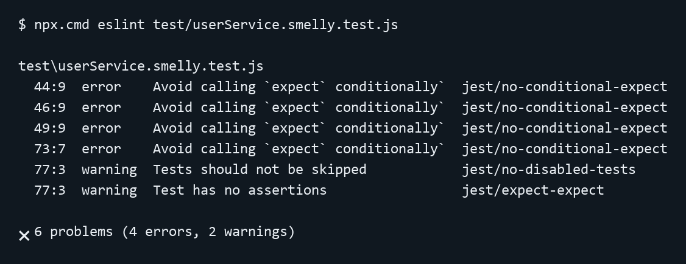

# PUC Minas

**Disciplina:** Teste de Software

**Trabalho:** Refatoração de Testes e Detecção de Test Smells

**Nome completo:** Islayder Jackson Ribeiro de Oliveira

**Matrícula:** 859552

17 de outubro de 2026

<!-- pagebreak -->

## 1. Análise de Test Smells

A análise usou o repositório `CleitonSilvaT/test-smelly`, commit
`fc5cc1206e9bcd40d5b6c705d48a67659672c6c5`. A suíte original está em
`test/userService.smelly.test.js`, diferentemente do caminho `__tests__/`
informado no enunciado. Antes da refatoração, `npm test` aprovou 4 testes e
registrou 1 desativado. Foram selecionados três smells sustentados pelo código.

**Eager Test — linhas 18–30.** O teste “deve criar e buscar um usuário
corretamente” verifica duas operações diferentes. Os trechos abaixo pertencem
ao mesmo teste, separados apenas por comentários e uma linha vazia:

```js
expect(usuarioCriado.id).toBeDefined();
```

```js
const usuarioBuscado = userService.getUserById(usuarioCriado.id);
expect(usuarioBuscado.nome).toBe(dadosUsuarioPadrao.nome);
expect(usuarioBuscado.status).toBe('ativo');
```

As ações e assertivas intercaladas dificultam localizar a responsabilidade que
falhou: uma falha na criação impede verificar a busca. A refatoração separou
os contratos. No teste de busca, cadastrar o usuário passou a ser preparação;
somente consultar pelo ID constitui a ação principal.

**Conditional Logic in Test — linhas 40–49 e 70–73.** Na desativação, a
expectativa depende da execução de um laço e de uma condição:

```js
for (const user of todosOsUsuarios) {
  const resultado = userService.deactivateUser(user.id);
  if (!user.isAdmin) {
```

O fluxo reproduz a decisão que deveria verificar. Mudanças nos dados podem
deixar um cenário sem execução e dificultam diagnosticar falhas. Casos
determinísticos separados verificam usuário comum e administrador. No teste
de menor de idade, o `expect` está exclusivamente no `catch`; se não houver
exceção, o teste também passa. Essa segunda manifestação pode ocultar a remoção
da validação de idade. A solução usa `toThrow`, conforme a seção 2.

**Fragile Test — linhas 61–63.** O relatório é comparado por uma linha com
pontuação e quebra de linha exatas:

```js
const linhaEsperada = `ID: ${usuario1.id}, Nome: Alice, Status: ativo\n`;
expect(relatorio).toContain(linhaEsperada);
expect(relatorio.startsWith('--- Relatório de Usuários ---')).toBe(true);
```

Espaçamento, decoração e ordem dos campos podem mudar sem alterar as informações
do relatório; o serviço declara que seu formato pode mudar. Esse acoplamento
provoca falhas cosméticas e manutenção desnecessária. Os novos testes verificam
ID, nome, status e título inicial, aceitando alterações de layout. O teste com
um único usuário evita que o status de outro cadastro satisfaça a expectativa.

Como achado adicional, há um Disabled Test (teste ignorado por `test.skip`)
nas linhas 77–79. Esse achado não integra a seleção dos três smells acima;
o cenário vazio foi implementado na suíte limpa. Não foram atribuídos outros
smells sem evidência suficiente no código.

<!-- pagebreak -->

## 2. Processo de Refatoração

O teste de menor de idade foi escolhido porque pode produzir um falso positivo.
O trecho real abaixo está nas linhas 70–74 do arquivo original.

**ANTES — `test/userService.smelly.test.js`:**

```js
try {
  userService.createUser('Menor', 'menor@email.com', 17);
} catch (e) {
  expect(e.message).toBe('O usuário deve ser maior de idade.');
}
```

**DEPOIS — `__tests__/userService.clean.test.js`:**

```js
test('rejeita um usuário menor de idade com a mensagem esperada', () => {
  // Arrange
  const nome = 'Menor';
  const email = 'menor@email.com';
  const idade = 17;

  // Act: a chamada é adiada para o matcher observar a exceção.
  const criarUsuario = () => userService.createUser(nome, email, idade);

  // Assert
  expect(criarUsuario).toThrow(new Error('O usuário deve ser maior de idade.'));
});
```

O Arrange explicita os dados do cenário. O Act define a chamada adiada: em
testes de exceção, a execução ocorre dentro do matcher no Assert, para que o
Jest observe o lançamento. A expectativa é incondicional e falha quando a
exceção não ocorre ou sua mensagem exata diverge. Usar `new Error(...)` como
expectativa preserva a igualdade de mensagem do original; uma string isolada
em `toThrow` aceitaria uma correspondência parcial. A leitura revela qual
regra está protegida, tornando o diagnóstico e a manutenção mais seguros.

**Correspondência semântica entre as suítes:**

| Teste original | Casos correspondentes na suíte limpa |
| --- | --- |
| Criar e buscar | Criar usuário comum ativo; buscar pelo ID com nome e status preservados. |
| Desativar não administradores | Desativar comum e consultar cadastro; recusar administrador e confirmar status ativo. |
| Relatório formatado | Título inicial; ID, nome e status; inclusão dos dois usuários, sem layout exato. |
| Menor de idade | Rejeição aos 17 anos e mensagem obrigatória com `toThrow`. |
| Caso vazio desativado | Relatório com a mensagem real “Nenhum usuário cadastrado.”. |

Os 17 novos testes acrescentam campos obrigatórios, limite de 18 anos,
administrador explícito, IDs inexistentes e relatório após desativação.
`_clearDB()` é usado somente nos hooks de isolamento; o banco pertence ao
módulo e uma nova instância não o limpa. Consultas após desativar observam o
efeito da ação, sem constituir outro cenário. Produção e suíte original
permaneceram intactas. A matriz completa está em `docs/VALIDACAO.md`.

<!-- pagebreak -->

## 3. Relatório da Ferramenta

A análise utilizou ESLint 8.57.1 e eslint-plugin-jest 29.17.0. A configuração
.eslintrc.json mantém os ambientes es2021, node e jest/globals; os presets
eslint:recommended e plugin:jest/recommended; e o parser latest/module.
As regras explícitas são jest/no-disabled-tests (warn),
jest/no-conditional-expect (error) e jest/no-identical-title (error).
A primeira tentativa com ESLint 10.13.0 exigiu outro formato de configuração;
a versão 8.57.1 foi fixada para atender ao modelo solicitado, sem silenciar regras.



A Figura 1 apresenta o resultado da execução do ESLint sobre a suíte de testes
original. Foram identificados quatro erros relacionados à regra
jest/no-conditional-expect e dois avisos, associados às regras
jest/no-disabled-tests e jest/expect-expect.

Os erros indicam expectativas condicionais: três nos ramos da desativação e
uma no catch, que pode deixar o teste sem validação quando não ocorre exceção.
Os avisos apontam o teste ignorado e a ausência de assertivas nesse caso.
Não houve títulos idênticos. O ESLint detectou esses problemas estruturais;
a identificação do Eager Test e do acoplamento à formatação do relatório
exigiu análise manual.

Na validação final, npm test aprovou 2 suítes e 21 testes, sem falhas;
o único skip pertence ao original preservado. O clean retornou 0 erros e
0 avisos no ESLint, com código de saída 0. O lint completo mantém os 4 erros
e 2 avisos exclusivamente no original. A suíte limpa, executada isoladamente,
atingiu 100% de instruções, ramos, funções e linhas do serviço; inicialmente,
a suíte original tinha 85,71% de instruções/linhas e 75% de ramos. A cobertura
complementa a comparação de comportamentos, sem provar ausência de defeitos.

## 4. Conclusão

O teste com `catch` mostra que passar não basta: sem lançar a exceção, ele
continuava verde. Expectativas incondicionais, cenários separados e dados
locais tornam o comportamento esperado explícito e reduzem custos de
manutenção. Verificar informações do relatório sem fixar sua decoração
melhora a robustez frente a mudanças legítimas. A análise estática oferece
verificação repetível, enquanto a revisão manual examina responsabilidades
e significado. Em conjunto, esses cuidados sustentam a evolução do projeto
com testes que explicam regras de negócio e ajudam a detectar regressões.
